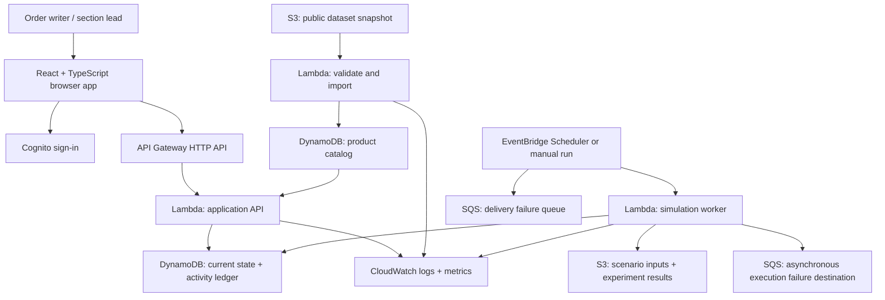

# Order Writer Review and Shift Handoff Assistant

**Design document · Draft v3 · November 4, 2026**

## 1. Problem and intended users

Order writers cover the same grocery section across blocks of consecutive shifts, and somebody orders every night. Both writers can already see each other's orders and case quantities. The problem is the effort required to reconstruct several days of sales, ordering decisions, stock changes, and deliveries by opening individual product histories. After several days away, the returning writer lacks the context the other writer accumulated while working those shifts.

Each writer orders what seems right that night. Without a quick summary of recent trends and the combined effect of pending orders, their judgments can produce too much or too little inventory. Consecutive orders for the same item are normal and are not inherently duplicates.

The primary user is a grocery-section order writer, initially working with snacks. A section lead is a secondary user who maintains product settings and reviews exceptions. The first pilot covers one simulated store, one section, and two writers.

**Product objective:** help a returning writer make informed nightly ordering decisions without opening every item's history. Summarize changes across the entire section since their last worked shift, explain recent demand and ordering patterns, and show how tonight's proposed quantities affect projected stock.

This is an independent portfolio prototype using public product data and synthetic operations. It is not an official Trader Joe's system and has no supplier or point-of-sale integration.

### Evidence and existing workflow

The user's firsthand experience is the primary requirement source for this pilot: orders are written nightly, coworkers can inspect previous case quantities, and reviewing every product after several days away is impractical. The particular shift pattern and interface experience should not be generalized to every Trader Joe's store.

Trader Joe's [official Episode 44 podcast transcript](https://www.traderjoes.com/content/dam/trjo/pdfs/transcripts/InsideTJs-Episode44-Transcript.pdf) describes ordering, merchandising, and product knowledge as section responsibilities. It also discusses kaizen, reducing bureaucracy, and crew empowerment. It does not document the complete internal ordering interface or validate our proposed feature set.

Public, self-reported crew accounts support the hypothesis about review effort:

- A [paper-versus-tablet discussion](https://www.reddit.com/r/tjcrew/comments/1bhjp2g/) describes the benefit of seeing sales averages in cases and several days of order history together, without loading each product page. It also notes that paper information can become outdated.
- An [ordering-time discussion](https://www.reddit.com/r/tjcrew/comments/1lwix1n/ordering/) describes different approaches, including product-level sales review, case counts, shelf capacity, and experience with a section.
- A [historical-sales discussion](https://www.reddit.com/r/tjcrew/comments/1qw0boe/super_bowl_weekend/) describes existing tablet history, suggested quantities, and section/date-range reports. These capabilities overlap parts of this proposal and must be investigated before claiming a missing feature.

These accounts span different stores and dates, are not official instructions, and may describe older software. They provide supporting observations, not proof of a universal workflow or a verified integration path.

### Alignment with store values

This tool supports order writers' judgment by reducing the time needed to reconstruct changes across shifts. It brings existing information into an actionable section-wide summary, helping crew make informed decisions while preserving local ownership of ordering.

- **Kaizen:** improve a recurring nightly task in a measurable, incremental way.
- **No bureaucracy:** shorten the path from a question about a product to the relevant context, without requiring another approval layer.
- **Crew empowerment and local decisions:** explain calculations, retain writer overrides, and preserve context about local events, displays, and customer demand.

This is a design rationale based on the official transcript, not company endorsement. Do not equate crew empowerment with employee scoring: the product does not rank writers or assign blame for excess stock or shortages.

## 2. MVP and boundaries

The first version supports:

1. A section-wide nightly ordering worksheet with recent unit sales, trends, stock counts, incoming cases and dates, proposed quantities, and data freshness; routine review does not require opening each product.
2. Draft orders visible to both writers, attributed to their creator.
3. An explainable review of tonight's proposed quantities against recent trends, arrival dates, pending quantities, and configured stock targets. Prioritize projected shortages and excess coverage, rather than flagging consecutive nightly orders by themselves.
4. Recording an externally placed order as pending delivery.
5. Partial receiving, cancellation of unreceived quantities, and inventory adjustments.
6. Shift notes, a timestamped activity feed, and a summarized view of changes since the returning writer's last worked shift.
7. A simulation that exercises demand changes, deliveries, and blocks of consecutive shifts by different writers.

Deferred: real supplier submission, live store inventory, automatic purchasing, machine-learning forecasting, expiry/lot tracking, multiple warehouses, and native mobile apps. A simple browser interface is sufficient for the pilot; detailed visual design comes later.

The system cannot prevent a purchase made outside it. Writers must record external orders promptly. Its benefit depends on timely stock and sales inputs; the interface must make stale or missing information visible. The prototype uses simulated sales. A real deployment needs an authorized sales feed or recorded observations; order history alone cannot establish customer demand. When inputs are insufficient, show order/receipt summaries and label demand-based projections unavailable rather than inventing trends.

**First usable milestone:** a read-only ordering review assistant over imported synthetic records, with optional handoff notes and draft quantity previews. It is not a replacement for the existing ordering system. The order/receipt commands below support the simulator and a later operational pilot; they are not prerequisites for testing whether the summary saves time.

Import product-day sales, order lines, receipts, and optional stock observations in one batch rather than requiring writers to retype each product's history. Each record includes source, scope/store, SKU, business date or event time, units, and a stable source record ID; order records additionally include case-pack snapshot and expected arrival. Missing observations remain unknown, never zero by default. Corrections replace a source record by revision and rebuild affected summaries without applying the same stock delta twice. Only synthetic inputs are planned initially; no access to internal reports or exports is assumed.

## 3. Architecture style

**A serverless modular monolith with an event-driven background pipeline.**

The backend is one codebase divided into catalog, inventory, orders, handoffs, and simulation modules. A small number of Lambda functions expose these modules or run background work. This avoids the coordination overhead of independently deployed microservices for a small application.

User commands use synchronous API requests and DynamoDB transactions. Background events handle dataset imports and simulation steps. Critical stock and pending-order totals are updated in the command transaction, not by a later notification that might arrive out of order.

An append-only activity ledger accompanies current-state records. This is **not full event sourcing**: DynamoDB current-state records are authoritative for operations, while ledger entries explain changes and support review.



## 4. Proposed stack

- **Frontend:** React, TypeScript, Vite; responsive browser UI. Proposed hosting is AWS Amplify Hosting, subject to sandbox availability. Local hosting is sufficient while building the backend.
- **API:** API Gateway HTTP API, with Cognito JWT authentication.
- **Backend:** Python Lambda functions using boto3; domain logic shared by the API and simulator.
- **Database:** DynamoDB on-demand tables for catalog and operations.
- **Files:** private S3 buckets for source snapshots, scenario configurations, and result exports. Product images are not required.
- **Scheduling:** EventBridge Scheduler, optionally invoking a simulation worker at a modest interval. Accelerated experiments can run manually without waiting for wall-clock days.
- **Failure capture:** an SQS dead-letter queue for Scheduler delivery failures; configure asynchronous Lambda failure handling separately, since a delivered invocation can still fail during execution.
- **Operations:** CloudWatch, scoped IAM roles, and AWS Budgets where the sandbox permits them.
- **Infrastructure:** AWS SAM/CloudFormation for repeatable backend deployment. Pin application dependencies and keep configuration in version control.
- **Verification:** pytest for domain rules and simulator reproducibility; a small set of API/integration tests and browser checks for the two-writer workflow.

Before provisioning, verify the sandbox's allowed services, IAM restrictions, region, credit expiration, and billing visibility. This document does not record a deployment.

## 5. Data source and what must be simulated

Use the public [cmoog/traderjoes project](https://github.com/cmoog/traderjoes) and its [price-history CSV](https://data.traderjoesprices.com/dump.csv). Its documented schema includes SKU, product title, retail price, observation timestamp, store code, and availability. The project says its prices are sourced from Chicago South Loop, store 701. The repository has an MIT license; preserve its license and provenance, and review reuse conditions before publishing the dataset.

The repository's age does not establish the latest observation date. Inspect the actual snapshot before making freshness claims. The full CSV is about 180 MB according to its download response; store it in S3 and stream it in bounded chunks rather than assuming every import is a tiny file.

The dataset does **not** establish unit sales, stock levels, case packs, wholesale costs, supplier lead times, delivery reliability, shelf capacity, or current physical stock. Do not interpret its availability flag as measured store inventory.

Select an initial 20–30 snack products after checking coverage and names. Snack classification may require manual review. Store SKUs as strings to preserve leading zeros. Preserve raw rows and timestamps; report invalid rows and duplicates. An import key based on snapshot identity and chunk number prevents repeated events from duplicating work.

For each pilot product, enter clearly marked synthetic settings: units per case, initial units, average daily demand, delivery lead time, safety stock, review interval, and optional capacity. Use observed retail price only for a labeled retail-value approximation. It is not acquisition cost, profit, or a current store price.

## 6. Core quantities and recommendation rule

**Use individual sellable units internally.** Writers order in cases; the system converts cases to units using a versioned case-pack value. Receiving uses actual units received. Never add cases and units directly.

For a product:

```text
inventory position = on-hand units + outstanding ordered units
target units = ceil(average daily demand × (lead-time days + review-interval days)
                    + safety-stock units)
suggested units = max(0, target units − inventory position)
suggested cases = ceil(suggested units / units per case)
```

This is a transparent starting rule, not a validated forecasting model. The operational recommendation uses a trailing average from observed fulfilled sales, or an explicitly labeled writer-entered estimate when history is insufficient. Synthetic demand-generation parameters remain separate from the estimate shown to writers; the recommender cannot read the simulator's hidden demand settings. Flag stockout periods because fulfilled sales can understate demand. Open drafts are displayed as intentions and are not counted as confirmed incoming stock. Otherwise an abandoned draft could suppress a necessary order.

Use a daily projection as the decision check: start with on-hand units, add confirmed pending units on their expected arrival dates, and subtract estimated daily demand. Project through the next delivery plus review interval. Show shortages before a new order can arrive separately from quantities a new order can address. Never suppress a near-term shortage just because a later delivery makes the overall inventory position look sufficient. Round-to-case effects and capacity warnings remain visible. Writers can override a recommendation with a reason; the system records the reason and the state used for the decision.

**Example:** a writer returning after five days sees, directly on the worksheet, that an item's recent daily sales rose, four cases are due tomorrow, and the coworker noted increased weekend demand. Adding three more cases immediately updates projected coverage and explains any excess. The writer can revise the quantity or retain it with a reason. Specific example quantities are illustrative, not demand inferred from the public dataset.

## 7. User workflow and order lifecycle

At shift start, default to the period since the writer's last recorded worked shift, with an adjustable date range. Do not infer worked shifts from page views. Acknowledge events independently: seeing a note is not the same as working a shift or agreeing with its content.

The worksheet summarizes recent and preceding equal-length periods of observed unit sales, days stocked out, orders by writer, receipts, overdue deliveries, stock-count age, and relevant notes. Show absolute changes; omit percentage changes with a zero baseline. Label comparisons with unequal weekday mixes and limited history rather than presenting them as proven demand shifts. A zero-sales stockout day is not evidence of zero demand.

Prioritize products needing attention, while keeping all products searchable. Inline details explain warnings, for example: "Three additional cases would take projected stock above your configured target; four cases are already due tomorrow." Trend summaries and alerts use explicit calculations and templates in the MVP; an LLM is unnecessary.

Suggested quantities, when supplied by an authorized source or simulated for the demo, appear as contextual inputs alongside our calculations. Do not claim to reproduce Trader Joe's existing suggestion logic. Notes can explain displays, holidays, warehouse restrictions, and unusual demand; an unexplained sales change must not be presented as having a known cause.

Per-line order states:

```text
DRAFT → ORDERED → PARTIALLY_RECEIVED → RECEIVED
  └→ CANCELLED          └→ close remainder as CANCELLED
```

`ORDERED` means the writer records an order already placed outside the application. It does not imply supplier acknowledgement. The demo simulator plays the supplier role. A real integration would need additional submitted/acknowledged/rejected states.

Use one SKU per order line in the MVP. A multi-product order is a batch of independently recorded lines, each with its own result; do not promise all-or-nothing confirmation of an unlimited basket.

Writers may revise drafts. Once ordered, changing a quantity requires an auditable amendment. A request to cancel a real external order leaves its units pending until cancellation is confirmed externally. Receipt commands identify the order line and delivery, increment on-hand, and decrement pending quantities atomically. Received units cannot be cancelled retroactively. Returned/damaged stock uses a separate adjustment with a reason.

## 8. Concurrent updates and accurate external-order records

Visibility alone is insufficient: two people can read the same screen simultaneously. Each store/SKU state record therefore carries a revision number.

When a writer records an order, the API uses a DynamoDB transaction to:

1. Require that the submitted revision matches current store/SKU state.
2. Create or transition the order line with the expected prior state.
3. Increment outstanding units and advance the store/SKU revision.
4. Add an immutable activity record.
5. Save a durable idempotency record for the request.

Two simultaneous writes against the same revision cannot both commit. A stale draft review receives `409 Conflict` and fresh context before the user makes an external purchase. If a purchase has already happened, the system must still record that fact: the backend reloads current state and retries the transaction with the same idempotency key and unchanged actual quantity. Repeated contention creates a visible reconciliation task with the original submitted order facts. Never hide a real incoming order merely because its quantity exceeds a recommendation. Alerts assist decisions; they do not undo supplier purchases.

Use the same pattern for receipts, simulated sales, cancellations, and adjustments. Reject negative on-hand values and receipts exceeding the outstanding quantity. A new physical stock count is an absolute observation with a timestamp and expected revision; it must not silently overwrite a sale that arrived after the writer loaded the page.

Use strongly consistent reads of authoritative base-table records for confirmation and current stock. Secondary indexes may support browsing; they must not decide whether a stock-changing command is valid. AWS documents [concurrent-update controls](https://docs.aws.amazon.com/amazondynamodb/latest/developerguide/BestPractices_ImplementingVersionControl.html) and [transactional writes](https://docs.aws.amazon.com/amazondynamodb/latest/developerguide/transactions.html).

Every mutation includes a caller-generated idempotency key, payload hash, and authenticated user identity. Identical retries return the original result; reuse with different contents fails. This handles a successful write followed by a lost network response as well as duplicate background invocations.

## 9. Data model and access patterns

### Catalog table

`PK = PRODUCT#<sku>`, `SK = META`. Store name, source product ID, source snapshot, last observed retail price/date, source store, and classification provenance. Historical price observations use separate dated records if the application needs them; importing every historical observation into the operational database is unnecessary for this MVP.

### Operations table

Include environment/scenario and store scope in every partition key so simulation cannot modify live pilot records.

- Inventory: `PK = SCOPE#<scope>#STORE#<id>#SECTION#<section>`, `SK = SKU#<sku>`. Current units, outstanding units, revision, last physical count, case pack, and demand/target settings.
- Order line: `PK = SCOPE#<scope>#STORE#<id>#ORDER#<orderId>`, `SK = LINE#<lineId>`. SKU, ordered/received/cancelled units, creator, expected arrival, status, and revision.
- Activity: section partition, `SK = EVENT#<timestamp>#<eventId>`. Action, actor, SKU, quantity delta, order reference, reason, and before/after revisions.
- Handoff note: section partition, `SK = NOTE#<timestamp>#<noteId>`. Author, related SKU, message, status, and acknowledgement history.
- Daily product observation: section partition, `SK = DAY#<date>#SKU#<sku>`. Observed fulfilled sales, stockout flag, source, and observation completeness, used for section-wide trend queries. Simulation-only latent demand is stored outside this operational view.
- Worked shift: section partition, `SK = SHIFT#<date>#<shiftId>`. Writer, start/end times, and status; supports a returning writer's summary window.
- Request result: scoped request partition, storing payload hash and committed outcome.
- Simulation run/tick markers: run scope, storing scenario version, seed, completion state, and per-step progress.

Use a secondary index for open order lines by scope/store/SKU and expected date. Query the base section partition to list inventory, query the activity prefix for handoffs, and query an order partition for its lines. Add a separate section-status index only when a measured access pattern requires it. Avoid operational table scans.

S3 retains raw dataset snapshots, validation reports, complete scenario inputs, exogenous demand traces, and simulation exports. DynamoDB retains the small working state and audit references. Periodically reconcile outstanding totals against open order lines; flag discrepancies rather than silently rewriting totals during a user's command.

## 10. API outline

- `GET /sections/{id}/inventory`: current stock, pending units, count freshness, revisions.
- `GET /sections/{id}/ordering-summary?since=...`: section-wide trends, recent orders, expected arrivals, notes, and calculation/data provenance. Return a computed-through timestamp; authoritative order commands still validate current state.
- `POST /sections/{id}/order-preview`: evaluate proposed cases supplied in the request body against dated stock projections; return explanations and state revisions without creating an order or changing inventory. The summary endpoint supplies existing context; this endpoint handles unsaved quantity edits.
- `GET /sections/{id}/activity?cursor=...`: paginated shift history.
- `POST /order-lines`: create a draft.
- `POST /order-lines/{id}/record-order`: record an external purchase with expected revisions and idempotency key.
- `POST /order-lines/{id}/receipts`: receive actual units against a pending order.
- `POST /order-lines/{id}/cancel-remainder`: cancel an unreceived quantity.
- `POST /inventory/{sku}/adjustments`: count corrections or damage, with reason and revision.
- `POST /sections/{id}/notes`: add a handoff note.
- `POST /simulation-runs`: create an isolated, versioned scenario; operator-only.

Authenticate using Cognito; validate tokens at API Gateway and check store/section membership in the backend on every request. A user-provided store ID is not authorization. Scope idempotency records and file access the same way. See [API Gateway JWT authorizers](https://docs.aws.amazon.com/apigateway/latest/developerguide/http-api-jwt-authorizer.html).

For externally placed orders, `cancel-remainder` records a confirmed external cancellation and its reference/reason. A cancellation request alone is a note/status change and does not reduce incoming units. The read-only milestone enables summary, preview, notes, and simulation APIs; operational inventory/order mutation routes remain out of the writer interface until explicitly included in the pilot.

## 11. Sales and shift simulation

Generate latent demand, not merely recorded sales. Begin with daily Poisson demand per product, adjusted by configured weekday factors and optional demand spikes. More variable demand distributions can be a later experiment. All inputs are synthetic assumptions and remain visible in the scenario configuration.

```text
fulfilled sales = min(latent demand, available on-hand)
unmet demand = latent demand − fulfilled sales
```

Low recorded sales during a stockout must not be interpreted as low customer demand. The simulator has access to latent demand for evaluation; order writers and policies do not see future demand.

Start with daily ticks: receive deliveries due at the start of the day, apply that day's demand, then run that night's writer review. Someone reviews orders every night. Configure repeating blocks of consecutive shifts, including a five-day block followed by a three-day block as an illustrative scenario. Document this order because it affects outcomes. Daily resolution does not test simultaneous updates; use separate concurrent API tests for that case.

Pre-generate an immutable demand trace per product/day and a documented delivery environment. A fixed seed, stable product ordering, pinned random-generator version, and separate random streams for demand, disruptions, and writer behavior make experiments reproducible. A seed alone is insufficient if code changes the order of random calls.

Compare two explicit policies:

- **Raw-history baseline:** both writers can access all orders and observations, but must reconstruct context from individual product histories. For simulated decisions, define and disclose a bounded-review heuristic: review a configurable number of products per shift; other products use the writer's last reviewed estimate. This is a hypothesis about attention constraints, not observed worker behavior.
- **Summarized-view policy:** the same records are automatically aggregated across the section; writers receive recent trends, arrivals, and projected effects without manually opening each history. Use the same replenishment rule and review budget, with an explicit exception-priority rule.

Both policies have access to the same underlying information and use the same initial stock, product settings, demand trace, nightly review schedule, and delivery assumptions. Each scenario has separate operational state. Vary the review budget and staleness assumptions, including a full-review baseline where the expected summarization advantage may vanish. The simulation tests modeled decision support; it cannot establish how much time a real writer saves.

Separately test the interaction with writers: provide identical multi-day histories and ask them to identify changed demand, incoming quantities, and items needing review. Compare the prototype with the best existing workflow available, including section-wide reports or paper guides where applicable, as well as the item-detail workflow. Measure completion time and errors, counterbalance interface order, and collect explanations. This directly tests the primary goal of reducing reconstruction effort without assuming existing tools lack summary capabilities.

Evaluate at least 30 seeds over a proposed 60-day horizon, with low/high demand and reliable/delayed delivery scenarios. Report distributions and paired differences, including runs where the tool performs worse.

A simulation tick must be restartable. Use a conditional run lease and deterministic run/day/SKU/action IDs; record product-step completion so retrying after a partial failure cannot repeat sales or deliveries. Cap invocation work and resume from a cursor. Do not depend on one long-running invocation for the whole experiment. AWS supports [scheduled Lambda invocation through EventBridge Scheduler](https://docs.aws.amazon.com/lambda/latest/dg/with-eventbridge-scheduler.html).

## 12. Success measures and verification

Measure operational outcomes together so reducing stockouts by ordering unlimited stock cannot look like success:

- **Fill rate:** total fulfilled units / total latent demand; omit or mark undefined when demand is zero.
- **Stockout product-days:** product-days with unmet demand.
- **Excess units:** units above the configured capacity or target, with the selected definition reported.
- **Average on-hand:** mean daily units per product and across the section.
- **Over-target proposals:** proposed quantities that would exceed a configured stock/coverage target; report context and overrides. Consecutive nightly orders are not counted as errors by themselves.
- **Handoff usefulness:** time and accuracy when returning writers identify trends, pending quantities, and recent changes across the section without opening every product history.

Do not report waste reduction without an expiry model, or profit savings without real acquisition costs. Simulated success demonstrates behavior under assumptions, not proven business impact.

Required checks: simultaneous order writes, durable recording of an already-placed external order after contention, duplicate request retry, partial receipt followed by confirmed cancellation, stale stock count, failed tick replay, cross-store access rejection, units/case conversion, pending-total reconciliation, incomplete trend data, zero baselines, and summaries spanning consecutive shift blocks. The low-level concurrency test must show only one write commits against a shared revision; retry handling must preserve all actual external-order facts.

## 13. Reliability, cost, and limitations

Keep raw imports immutable, constrain import triggers to the source location, and avoid writing derived files back into the triggering path. Record snapshot/checksum and chunk progress. Failed imports expose a report and resume safely.

Use private buckets, least-privilege roles, TLS, and encryption at rest. Log request/run IDs and sanitized errors rather than full notes or user tokens. Track command conflicts, API failures, stale counts, import errors, reconciliation mismatches, and failed simulation runs. Store simulation state separately from pilot state and disable scheduled simulation when not demonstrating it.

**Budget: $500 AWS sandbox credits; this is a ceiling, not a spending target.** Target an initial $50 pilot allocation, then estimate further work from measured usage. That allocation is not a price quote or an enforced cap. Check credit applicability, expiration, and service restrictions before deployment. Use low concurrency, bounded simulation horizons, modest log retention, and no always-on compute for the MVP. Budget alerts are notifications, not a guaranteed hard spending limit.

The main product risk is whether the summary is accurate, fast, and useful enough to replace manual history review. Data freshness and recording effort matter as much as calculations. DynamoDB fits the bounded access patterns, but ad hoc relational reporting would be easier in SQL. Keep that tradeoff explicit rather than adding database complexity just for a portfolio.

### Outstanding issues to validate

1. **Overlap with existing reports:** compare the prototype with the best existing section-wide workflow available at the user's store, not only a deliberately inconvenient item-by-item interface. If an existing report already solves the task, focus on the remaining handoff context or reconsider the feature.
2. **Data access and extra work:** the public catalog cannot power actual demand summaries. Test with synthetic batches first. Any future internal-data connection needs an authorized path; copying the same facts into a second app could erase the time savings.
3. **Freshness and physical stock:** shelf gaps may coexist with backstock, missing deliveries, or incorrect counts. Show provenance, shelf/backstock distinctions when recorded, and uncertainty. Avoid precise coverage claims when stock observations are unreliable.
4. **Misleading trend comparisons:** different weekday mixes, stockouts, short history, displays, and warehouse restrictions can change observed sales. Show comparison periods and contextual flags; do not automatically label every change a demand trend.
5. **Alert fatigue:** ordinary nightly replenishment is not an error. Test configurable thresholds and exception priorities, keep the full section accessible, and measure unnecessary warnings as well as missed issues.
6. **Validation and scope:** an experiment can demonstrate performance under synthetic assumptions, but only writer testing can establish usability. Keep the first milestone centered on review and handoff, with no automated supplier actions or employee performance judgments.

## 14. Delivery plan and decisions before implementation

1. Validate the workflow with the user: nightly order cadence, blocks of worked shifts, existing reports and suggested quantities, available sales inputs, what a case means, and how receipts/cancellations are communicated. Compare the best existing workflow before adding another one.
2. Inspect the public snapshot, select snack SKUs, and create a versioned synthetic scenario.
3. Build synthetic batch import and a read-only section summary, optional notes, and draft previews; demonstrate a handoff after several days away.
4. Build and test transactional stock/order commands for the simulator, then add repeatable experiments and a timed review exercise against the existing workflow. Report outcomes and limitations.
5. Refine usability with order writers, including warning usefulness and local judgment. Assess whether the time savings justify the data-entry/import effort.
6. Consider operational mutation routes, forecasting, or authorized integrations only after the handoff workflow works.

Open decisions: actual store timezone; writer versus lead permissions; case-pack assumptions; review/delivery cadence; capacity and safety-stock settings; which sandbox services are allowed; and whether the pilot needs external-order references.

**Before proceeding:** review this proposed stack and the serverless modular-monolith architecture with event-driven background jobs. Nothing in this document places a real supplier order, provisions AWS resources, or claims access to Trader Joe's internal systems.
