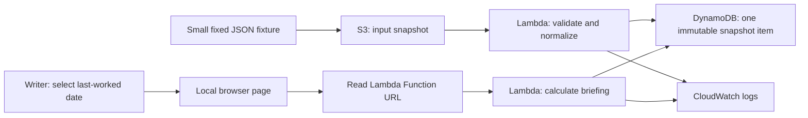

# Since Your Last Shift

**Product and architecture design · Draft v6 · November 4, 2026**

## 1. Purpose and portfolio objective

A read-only briefing dashboard helps a grocery order writer catch up on section activity after several days away. The writer selects the last date they worked and sees what sold, what coworkers ordered, what arrived, what is still pending, and relevant handoff notes in one view.

The project demonstrates **solutions architect and product owner thinking**: defining the actual user problem, choosing a small valuable scope, separating evidence from assumptions, designing an appropriate AWS architecture, and explaining tradeoffs and validation. It is not a production ordering system.

**Core question:** “What changed while I was away that I should review before writing tonight’s order?”

The initial target is a one-hour working prototype, assuming development tools and AWS sandbox permissions are ready. Setup delays can extend deployment; a working local demonstration remains the fallback. This document supersedes the broader operational inventory and ordering scope in earlier drafts.

## 2. User problem and supporting evidence

The primary user is an order writer responsible for a grocery section such as snacks. Writers work blocks of consecutive shifts, with somebody ordering each night. They can already see each other’s orders. The difficulty is reconstructing several days of context by opening each product’s history, especially after time away from the section.

The user’s firsthand experience defines the pilot requirements. Public sources support, but do not establish, a universal workflow:

- Trader Joe’s [official Episode 44 podcast transcript](https://www.traderjoes.com/content/dam/trjo/pdfs/transcripts/InsideTJs-Episode44-Transcript.pdf) describes ordering, merchandising, and product knowledge as section responsibilities, alongside kaizen, reducing bureaucracy, and crew empowerment.
- A [crew discussion of paper and tablet order guides](https://www.reddit.com/r/tjcrew/comments/1bhjp2g/) describes the value of seeing sales averages and multiple days of order history together without opening each product page.
- A [crew discussion of historical sales](https://www.reddit.com/r/tjcrew/comments/1qw0boe/super_bowl_weekend/) describes existing section reports and product-history tools. The dashboard must be compared with those existing workflows, not presented as the first tool to show sales history.

Crew posts are self-reported, span different stores and dates, and may describe older software. The prototype is independent, unofficial, and not endorsed by Trader Joe’s.

**Values alignment:** reduce repetitive review work through a small improvement while preserving local judgment and product knowledge. Help writers understand the section; do not score employees, assign blame, or automatically place orders.

## 3. Product scope

### Must have for the prototype

1. Ten snack products and one week of clearly labeled simulated activity.
2. A last-worked-date selector and a visible data-through date.
3. A section-wide view of units sold, cases ordered, cases received, and outstanding deliveries.
4. Simple faster/slower sales indicators where sufficient history exists.
5. Read-only coworker notes with author and date.
6. A clear distinction between real public product metadata and simulated store activity.

The page should answer routine catch-up questions without requiring ten separate product-detail screens. Rows can expand to show supporting daily observations without leaving the briefing.

### Explicitly outside this version

No suggested order quantities, order entry, supplier actions, inventory adjustments, receiving commands, shelf-capacity calculations, authentication, live internal-data integrations, scheduled simulation, machine learning, notification system, or production concurrency workflows.

Facings, shelf capacity, current shelf counts, and backstock are intentionally deferred because this version does not recommend quantities or claim that an order will fit. Displaying fulfilled sales also does not establish unmet demand or current stock.

The prototype can show a snapshot of pending deliveries without managing an order lifecycle. All operational activity is pre-generated; the user only reads it and selects dates.

## 4. User story and experience

**User story:** “As an order writer returning after several days away, I want a section-wide summary of recent sales, orders, deliveries, and notes so I can regain context before writing tonight’s order.”

Example flow:

1. Open the dashboard and see “Demo: synthetic activity — data through November 4.”
2. Select the last date worked, such as November 1.
3. Review activity from November 2 through the snapshot’s data-through date.
4. Notice a product’s observed sales increased, see the cases recently ordered and still due, and read a coworker’s note about a changed display.
5. Continue making the ordering decision in the existing system.

The prototype treats the last-worked date as a complete business day and includes subsequent dates. It does not claim to know the actual end time of the shift. Selecting a date before available history shows that coverage is incomplete. A date with no subsequent observations shows no new activity; it must not invent a trend.

**Product knowledge:** present product identity, units per case, recent observed behavior, and crew observations together. Mark case sizes and operational observations synthetic in the demo. Keep calculated patterns separate from coworker explanations; a note about a display is an observation, not proof that it caused a sales increase.

## 5. System architecture style

**A small serverless application with event-driven input validation and a read-only HTTP endpoint.**

A single Python codebase has two handlers: one imports S3 snapshots; the other reads a snapshot and calculates the selected briefing. Deploy them as two Lambda functions so the public reader has no write permissions and cannot execute the import path. Calculation logic remains a small pure function, not another service.

S3 retains the original input for inspection and replay. The importer validates and normalizes it before one atomic DynamoDB write. The read handler fetches the configured immutable snapshot by ID and calculates totals for the requested date. Ten products and seven days are small enough that caching and precomputation are unnecessary.

## 6. Component decisions: do we actually need this?

Each component must support either the user task or the explicitly chosen AWS learning objective. Future scale alone is not sufficient justification.

- **A browser interface — needed.** The value is a section-wide view and date selection. Use plain HTML, CSS, and JavaScript for this one-page prototype; no React, TypeScript, Vite, or frontend build pipeline is required. A local Python standard-library HTTP server can serve the page. Reconsider a framework only if the UI grows into multiple interactive workflows.
- **Python — chosen for implementation.** It handles JSON, dates, validation, and aggregation with its standard library; boto3 provides AWS calls. No data-science library, model, or heavy validation framework is needed for this bounded schema.
- **S3 — retained for the cloud-ingestion objective.** A raw snapshot provides a visible input boundary and replayable source. The user task alone could work from a local file; S3 is justified by demonstrating a cloud import pipeline. Keep the bucket private and use only a small fixture.
- **Lambda — retained for serverless processing and HTTP access.** It runs on upload or request rather than requiring a server. Two functions separate permissions; both share the same small codebase. No workflow engine or additional aggregation function is needed.
- **DynamoDB — an explicit learning choice, not a scale requirement.** The agreed project demonstrates S3/Lambda/DynamoDB. One key lookup provides a simple validated-data boundary, but S3 could also serve the validated snapshot. If finishing the product demo takes priority over demonstrating DynamoDB, remove the database and read the validated S3 object instead; do not claim the workload requires it.
- **Lambda Function URL — chosen instead of API Gateway.** A built-in HTTPS endpoint is sufficient for one fictional read-only demo and two paths handled in code. API Gateway routing, authorizers, and API-management features are unnecessary here. See [AWS Function URL documentation](https://docs.aws.amazon.com/lambda/latest/dg/urls-configuration.html).
- **CloudWatch logs — retained for basic diagnosis.** Record import success/failure and unexpected read errors with short retention. No custom dashboards, tracing platform, or log-processing pipeline is needed.
- **AWS SAM/CloudFormation — chosen for reproducibility.** One small template makes resources, permissions, and cleanup reviewable for the portfolio. If SAM is unavailable, report setup time separately; do not introduce CDK, Terraform, and SAM together or silently claim a console-only deployment is reproducible.
- **A fixed JSON fixture — sufficient for synthetic data.** Hand-author ten products and seven days, including one incomplete observation and one partial receipt. A random generator, probability distribution, seed, scheduled simulator, and repeated experiments add no value to this read-only milestone.
- **Small calculation tests — needed for trust.** Use Python's standard-library unittest to check date boundaries, pending cases, and missing observations. Do not build a large testing framework or tests that only restate the implementation.

Also excluded: authentication for fictional demo data, public frontend hosting, queues, Scheduler, DynamoDB secondary indexes/streams, caching, import leases, snapshot publication pointers, and precomputed summaries for every date. Add a component only when a concrete requirement cannot be met adequately without it.

**Simplest product alternative:** one local JSON file and a browser page. **Selected AWS learning implementation:** S3 → import Lambda → DynamoDB, with a read Lambda Function URL for the local page. These satisfy different objectives; the portfolio should explain the choice honestly.

## 7. Dataset and synthetic input contract

The public [cmoog/traderjoes repository](https://github.com/cmoog/traderjoes) links a price-history CSV with SKU, product name, retail price, observation timestamp, store code, and availability. Its documented source store is Chicago South Loop, 701. Preserve attribution and source timestamps; review reuse conditions before distributing source data. Repository age is not a guarantee of observation freshness.

Extract only ten relevant product identities into a small curated fixture; do not build a general historical-price pipeline or upload the roughly 180 MB full CSV for this demo. Price history is not needed for the core briefing. Snack classification may require manual selection. Keep SKUs as strings.

The public source does not provide unit sales, actual orders, case sizes, deliveries, coworker notes, or current inventory. Hand-author a small fixed JSON fixture with explicit assumptions and expected totals. Upload that file to S3. There is no sales generator or simulation service in this milestone.

Suggested input collections:

- `snapshot`: unique ID, schema version, generated timestamp, store timezone, covered business dates, and `synthetic: true`.
- `products`: SKU, name, metadata source, source observation date, and synthetic units per case.
- `dailySales`: SKU, business date, fulfilled units, and completeness flag. Missing observations remain unknown rather than becoming zero.
- `orders`: stable order ID, SKU, author alias, ordered timestamp, ordered cases, case-pack snapshot, and expected delivery date.
- `receipts`: stable receipt ID, order ID, received timestamp, and actual received cases. The bounded demo allows partial receipts in whole cases with an unchanged case pack; mixed packs and cancellations are out of scope.
- `notes`: ID, SKU or section reference, author alias, timestamp, and text; all content is fictional.

Validate date ranges, known SKUs, positive case sizes, nonnegative sales, positive order/receipt quantities, unique IDs, valid references, and cumulative received cases no greater than ordered cases. Reject an invalid snapshot without replacing the last valid one. Use explicit timestamps for events and the configured store timezone for business-day aggregation.

## 8. Summary calculations and data model

On each read request, calculate the following for the requested last-worked date and each product:

- Fulfilled units sold after that date through the snapshot cutoff.
- Cases ordered in that interval, with writer attribution available in the expanded row.
- Cases received in that interval.
- Remaining cases from all orders outstanding at the cutoff, including orders placed before the selected interval.
- Expected arrival dates, overdue status at the cutoff, and notes from the selected interval.

Outstanding cases equal ordered cases minus receipts observed by the cutoff. Do not count orders or receipts dated after the cutoff. Flag overdue deliveries; do not assume they arrived. These are snapshot facts, not live warehouse confirmation.

For a simple sales indicator, compare the last three complete business days with the preceding three complete business days. Display both date ranges and average fulfilled units per day. This fixed comparison window is independent of the last-worked selector. If either window is incomplete, omit the indicator. If the earlier average is zero, show an absolute change rather than a percentage. Label results “observed sales,” not proven demand. Unequal weekday mixes are a known limitation; use same-weekday comparisons when more history is available.

**Bounded DynamoDB model:** one item per immutable snapshot, keyed by `snapshotId`. Store a checksum, coverage/provenance metadata, and the normalized snapshot as a JSON string. The importer enforces a 64 KiB serialized payload limit and bounded metadata, keeping the item well below [DynamoDB's 400 KB limit](https://docs.aws.amazon.com/amazondynamodb/latest/developerguide/Constraints.html). A larger snapshot fails validation; it does not silently grow into a production history store.

The browser has one demo snapshot ID in configuration. Both endpoint paths use that ID, so metadata and briefing refer to the same input. The read function uses `GetItem` rather than a scan, then parses and summarizes the small payload. This intentionally simple document model is suitable for the fixed demo; per-product storage is a later decision if updates or larger history justify it.

## 9. Import reliability and HTTP boundary

S3 triggers ingestion only under `incoming/`. Read and validate the entire bounded fixture before writing. The importer uses a conditional `PutItem` that creates a snapshot only if its ID is absent. If that ID already exists, compare checksums: identical input is an idempotent success; different content is rejected. To correct a fixture, give it a new snapshot ID and explicitly change the browser configuration after successful import.

One atomic item write eliminates partial-summary publication, multi-item completion checks, import leases, and a current-snapshot pointer. A failed validation leaves existing snapshots untouched. No cumulative stock deltas are applied on import, so retrying an event cannot double sales or receipts. Keep inputs immutable and hash normalized JSON deterministically. Log unexpected failures and manually re-upload or re-invoke during the demo; a production retry/recovery system is outside scope.

The read Lambda Function URL accepts only:

- `GET /snapshot?snapshotId=<id>`: coverage, supported last-worked dates, provenance, and synthetic-data status.
- `GET /briefing?snapshotId=<id>&lastWorked=YYYY-MM-DD`: all ten product summaries for that date.

Other methods or paths are rejected. Return clear validation errors for malformed or unsupported dates, and a not-found response for an unimported snapshot. Use a strongly consistent base-table read so a successful import is immediately visible. Each response includes snapshot ID, generated time, coverage dates, and missing-observation flags. There is no write/upload route and no AWS credential in the browser.

The Function URL uses unauthenticated access solely for fictional demo activity, with the exact local frontend origin allowed by CORS. CORS is not authentication. Real operational records require authentication and store authorization before exposure. Use narrow IAM roles, a low read-function reserved-concurrency limit, short timeouts, and remove the public URL after demonstration if no longer needed. These bound exposure and compute but are not a guaranteed hard cost cap. See [Function URL access controls](https://docs.aws.amazon.com/lambda/latest/dg/urls-auth.html).

## 10. Acceptance criteria and evaluation

The prototype is complete when:

1. Uploading a valid fixture to S3 creates one validated DynamoDB snapshot item.
2. The dashboard loads ten product rows and changes the activity window when the last-worked date changes.
3. Displayed sales, order, receipt, and pending-case totals match hand-calculated fixture expectations.
4. A pre-window order that remains outstanding is still visible; future events do not affect the cutoff.
5. Missing sales are not shown as zero, and incomplete comparisons do not produce trend claims.
6. Notes show author/date, and the page clearly labels simulated activity.
7. Replaying the same upload does not duplicate counts; an invalid snapshot leaves the last good briefing available.
8. The writer can answer “what changed, what is coming, and what needs my review?” without opening a separate page for every SKU.

Use standard-library Python unittest for aggregation boundaries, partial receipts, and missing observations. Verify conditional duplicate-import behavior in one AWS integration check, one import/read flow, and one browser walkthrough. The criteria are release checks, not work already completed.

To evaluate product value, give a writer the same fictional histories in the existing/report-style view and the new briefing. Compare catch-up time, missed facts, and perceived usefulness. Counterbalance the order when practical. This tests a hypothesis; do not claim proven time savings, lower stockouts, or reduced waste from a synthetic demo alone.

## 11. One-hour delivery plan

Timeboxes are targets, not guarantees:

- **0–10 minutes:** verify sandbox access and create ten-product/seven-day fixture with clear provenance.
- **10–25 minutes:** implement deterministic aggregation and the core calculation checks.
- **25–40 minutes:** deploy S3, DynamoDB, and import/read Lambdas with the read Function URL; verify one upload.
- **40–55 minutes:** connect a plain browser page with date selector, product rows, and notes.
- **55–60 minutes:** run the demo, check totals and missing-data labels, and capture the architecture/tradeoff explanation.

If AWS setup consumes the timebox, run the same aggregation and dashboard locally, then deploy afterward. Clearly report which AWS components are deployed versus proposed. Do not spend the hour adding auth, scheduled simulation, order editing, or recommendation logic.

## 12. Risks, decisions, and next steps

- **Existing-tool overlap:** compare with the best available section report. The value proposition is a faster returning-writer briefing and preserved context, not merely showing a sales total.
- **Real-data access:** the demo needs none. A future version needs an authorized import path and freshness guarantees; manual duplicate entry may erase its benefit.
- **Limited trend context:** seven days do not support seasonal conclusions or reliable demand forecasting. Show exact comparison windows and observed values.
- **Synthetic realism:** tune illustrative cases using the user's experience, but never present them as Trader Joe's measurements.
- **Scope creep:** recommendations and physical-capacity modeling are separate future decisions. Validate the briefing before reintroducing them.
- **Sandbox limits:** verify region, permissions, service availability, and credit expiration before deployment. The $500 credit balance is a ceiling; a proposed $50 initial spending allocation is not a cost estimate or hard enforcement. Keep usage bounded and remove unused resources after the demo.

Future steps, only if the briefing proves useful: authorized data imports, authentication, configurable comparison periods, richer product-knowledge notes, and later stock/capacity-aware order previews.

**Architecture checkpoint:** S3 → Python import Lambda → DynamoDB for validated snapshots; local HTML/JavaScript → read Lambda Function URL → DynamoDB for the briefing. The project demonstrates clear problem framing, deliberate scope, explicit assumptions, measurable acceptance criteria, and justified architecture choices.
