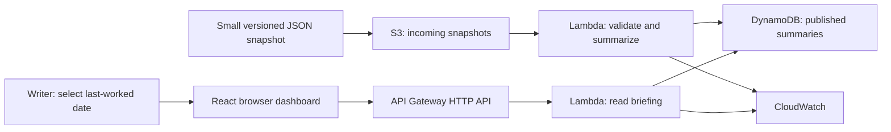

# Since Your Last Shift

**Product and architecture design · Draft v5 · November 4, 2026**

## 1. Purpose and portfolio objective

A read-only briefing dashboard helps a grocery order writer catch up on section activity after several days away. The writer selects the last date they worked and sees what sold, what coworkers ordered, what arrived, what is still pending, and relevant handoff notes in one view.

The project demonstrates **solutions architect and product owner thinking**: defining the actual user problem, choosing a small valuable scope, separating evidence from assumptions, designing an appropriate AWS architecture, and explaining tradeoffs and validation. It is not a production ordering system.

**Core question:** “What changed while I was away that I should review before writing tonight’s order?”

The initial target is a one-hour working prototype, assuming development tools and AWS sandbox permissions are ready. Setup delays can extend deployment; a working local demonstration remains the fallback. This document supersedes the broader operational inventory and ordering scope in earlier drafts.

## 2. User problem and supporting evidence

The primary user is an order writer responsible for a grocery section such as snacks. Writers work blocks of consecutive shifts, with somebody ordering each night. They can already see each other’s orders. The difficulty is reconstructing several days of context by opening each product’s history, especially after time away from the section.

The user’s firsthand experience defines the pilot requirements. Public sources support, but do not establish, a universal workflow:

- Trader Joe’s [official Episode 44 podcast transcript](https://www.traderjoes.com/content/dam/trjo/pdfs/transcripts/InsideTJs-Episode44-Transcript.pdf) describes ordering, merchandising, and product knowledge as section responsibilities, alongside kaizen, reducing bureaucracy, and crew empowerment.
- A [crew discussion of paper and tablet order guides](https://www.reddit.com/r/tjcrew/comments/1bhjp2g/) describes the value of seeing sales averages and multiple days of order history together without opening each product page.
- A [crew discussion of historical sales](https://www.reddit.com/r/tjcrew/comments/1qw0boe/super_bowl_weekend/) describes existing section reports and product-history tools. The dashboard must be compared with those existing workflows, not presented as the first tool to show sales history.

Crew posts are self-reported, span different stores and dates, and may describe older software. The prototype is independent, unofficial, and not endorsed by Trader Joe’s.

**Values alignment:** reduce repetitive review work through a small improvement while preserving local judgment and product knowledge. Help writers understand the section; do not score employees, assign blame, or automatically place orders.

## 3. Product scope

### Must have for the prototype

1. Ten snack products and one week of clearly labeled simulated activity.
2. A last-worked-date selector and a visible data-through date.
3. A section-wide view of units sold, cases ordered, cases received, and outstanding deliveries.
4. Simple faster/slower sales indicators where sufficient history exists.
5. Read-only coworker notes with author and date.
6. A clear distinction between real public product metadata and simulated store activity.

The page should answer routine catch-up questions without requiring ten separate product-detail screens. Rows can expand to show supporting daily observations without leaving the briefing.

### Explicitly outside this version

No suggested order quantities, order entry, supplier actions, inventory adjustments, receiving commands, shelf-capacity calculations, authentication, live internal-data integrations, scheduled simulation, machine learning, notification system, or production concurrency workflows.

Facings, shelf capacity, current shelf counts, and backstock are intentionally deferred because this version does not recommend quantities or claim that an order will fit. Displaying fulfilled sales also does not establish unmet demand or current stock.

The prototype can show a snapshot of pending deliveries without managing an order lifecycle. All operational activity is pre-generated; the user only reads it and selects dates.

## 4. User story and experience

**User story:** “As an order writer returning after several days away, I want a section-wide summary of recent sales, orders, deliveries, and notes so I can regain context before writing tonight’s order.”

Example flow:

1. Open the dashboard and see “Demo: synthetic activity — data through November 4.”
2. Select the last date worked, such as November 1.
3. Review activity from November 2 through the snapshot’s data-through date.
4. Notice a product’s observed sales increased, see the cases recently ordered and still due, and read a coworker’s note about a changed display.
5. Continue making the ordering decision in the existing system.

The prototype treats the last-worked date as a complete business day and includes subsequent dates. It does not claim to know the actual end time of the shift. Selecting a date before available history shows that coverage is incomplete. A date with no subsequent observations shows no new activity; it must not invent a trend.

**Product knowledge:** present product identity, units per case, recent observed behavior, and crew observations together. Mark case sizes and operational observations synthetic in the demo. Keep calculated patterns separate from coworker explanations; a note about a display is an observation, not proof that it caused a sales increase.

## 5. System architecture style

**A small serverless application with event-driven batch ingestion and a read-only request/response API.**

One Python codebase contains import/summary and read-API modules, deployed as two Lambda functions. There is no need for microservices, event sourcing, orchestration, or a persistent server.

Raw input stays in S3 for provenance and replay. Lambda validates and precomputes the bounded set of date-based summaries. DynamoDB serves those summaries without reprocessing the file on each page load. API Gateway exposes only read routes.

## 6. Proposed stack and tradeoffs

- **Frontend:** React, TypeScript, Vite. Run locally during the one-hour build; a local page may call the deployed API. Configure CORS for the exact local origin. Public frontend hosting is a later convenience, not a requirement.
- **Object storage:** private Amazon S3 bucket for small input JSON snapshots.
- **Compute:** Python AWS Lambda using boto3, with separate import and read permissions.
- **Database:** Amazon DynamoDB on-demand, one table for snapshot metadata and summaries.
- **API:** Amazon API Gateway HTTP API with read-only routes and modest throttling.
- **Diagnostics:** CloudWatch logs with short retention and compact import/API errors.
- **Deployment:** one AWS SAM/CloudFormation template for the backend, if permitted by the sandbox.

**Why this stack:** it demonstrates ingestion, transformation, persistence, and an API while using the requested S3/Lambda/DynamoDB services. For ten static products, a single JSON file could be technically sufficient. AWS here is a deliberate learning and portfolio choice, not a claim that this scale needs a database or distributed processing.

Precompute summaries because ten products and seven days create few combinations. Compute at request time or introduce incremental aggregates only if larger datasets make this approach unsuitable.

No Cognito, EventBridge Scheduler, queues, or forecasting service is required for this milestone. Removing them keeps the architecture proportional to the read-only demo.

## 7. Dataset and synthetic input contract

The public [cmoog/traderjoes repository](https://github.com/cmoog/traderjoes) links a price-history CSV with SKU, product name, retail price, observation timestamp, store code, and availability. Its documented source store is Chicago South Loop, 701. Preserve attribution and source timestamps; review reuse conditions before distributing source data. Repository age is not a guarantee of observation freshness.

Extract only ten relevant product identities into a small curated fixture; do not build a general historical-price pipeline or upload the roughly 180 MB full CSV for this demo. Price history is not needed for the core briefing. Snack classification may require manual selection. Keep SKUs as strings.

The public source does not provide unit sales, actual orders, case sizes, deliveries, coworker notes, or current inventory. Create those records locally using a small Python fixture generator with a fixed seed and explicit assumptions. Upload its completed JSON output to S3. The generator is a test-data utility, not a forecasting or operational sales system.

Suggested input collections:

- `snapshot`: unique ID, schema version, generated timestamp, store timezone, covered business dates, and `synthetic: true`.
- `products`: SKU, name, metadata source, source observation date, and synthetic units per case.
- `dailySales`: SKU, business date, fulfilled units, and completeness flag. Missing observations remain unknown rather than becoming zero.
- `orders`: stable order ID, SKU, author alias, ordered timestamp, ordered cases, case-pack snapshot, and expected delivery date.
- `receipts`: stable receipt ID, order ID, received timestamp, and actual received cases. The bounded demo allows partial receipts in whole cases with an unchanged case pack; mixed packs and cancellations are out of scope.
- `notes`: ID, SKU or section reference, author alias, timestamp, and text; all content is fictional.

Validate date ranges, known SKUs, positive case sizes, nonnegative sales, positive order/receipt quantities, unique IDs, valid references, and cumulative received cases no greater than ordered cases. Reject an invalid snapshot without replacing the last valid one. Use explicit timestamps for events and the configured store timezone for business-day aggregation.

## 8. Summary calculations and data model

For every supported last-worked date and product, calculate:

- Fulfilled units sold after that date through the snapshot cutoff.
- Cases ordered in that interval, with writer attribution available in the expanded row.
- Cases received in that interval.
- Remaining cases from all orders outstanding at the cutoff, including orders placed before the selected interval.
- Expected arrival dates, overdue status at the cutoff, and notes from the selected interval.

Outstanding cases equal ordered cases minus receipts observed by the cutoff. Do not count orders or receipts dated after the cutoff. Flag overdue deliveries; do not assume they arrived. These are snapshot facts, not live warehouse confirmation.

For a simple sales indicator, compare the last three complete business days with the preceding three complete business days. Display both date ranges and average fulfilled units per day. This fixed comparison window is independent of the last-worked selector. If either window is incomplete, omit the indicator. If the earlier average is zero, show an absolute change rather than a percentage. Label results “observed sales,” not proven demand. Unequal weekday mixes are a known limitation; use same-weekday comparisons when more history is available.

**DynamoDB keys:**

- Snapshot metadata: `PK = SNAPSHOT#<id>`, `SK = META`; includes coverage, provenance, schema version, import state, and source checksum.
- Product briefing row: `PK = SNAPSHOT#<id>#SINCE#<date>`, `SK = PRODUCT#<sku>`; includes summary values and bounded supporting detail.
- Publication pointer: `PK = DEMO`, `SK = CURRENT`; identifies the published snapshot.

The read API gets the pointer and queries the chosen date partition, then returns rows with source and data-through metadata. All reads in a response use the same snapshot ID. It does not scan the table. Input size and row detail are bounded to ten products and seven days for this version; no unbounded history is stored in one row.

## 9. Import reliability and API

S3 triggers ingestion only under `incoming/`. Use unique immutable snapshot IDs/object keys and an import lease to prevent concurrent workers from processing the same snapshot. Duplicate events for an already published checksum are no-ops; reuse of an ID with different content is an error. A failed or expired import can rebuild its deterministic rows safely.

Write all summary rows, retry any unprocessed writes, verify completion, and only then update the publication pointer. Incomplete imports never become visible. The first prototype accepts one newly uploaded snapshot at a time; if that restriction is removed, add a monotonic publication check so a slow older import cannot replace a newer one. Use strongly consistent reads for the publication pointer and base-table summary query so a newly published snapshot is readable immediately.

Routes:

- `GET /snapshot`: coverage, available last-worked dates, provenance, and synthetic-data status.
- `GET /briefing?lastWorked=YYYY-MM-DD`: all ten product summaries for that date.

Reject unsupported dates with a clear validation response; never silently substitute a different date. Return a snapshot ID, generated time, coverage dates, and clear indication of missing observations. API errors should distinguish absent data from zero activity.

The deployment deliberately exposes only fictional demo activity through an unauthenticated read API. It is unsuitable for actual store records. Authentication and store authorization are prerequisites to handling real operational data; CORS is not authentication. Keep S3 private and IAM roles narrow, and avoid an upload or mutation endpoint in this version.

## 10. Acceptance criteria and evaluation

The prototype is complete when:

1. Uploading a valid fixture to S3 produces a published DynamoDB snapshot.
2. The dashboard loads ten product rows and changes the activity window when the last-worked date changes.
3. Displayed sales, order, receipt, and pending-case totals match hand-calculated fixture expectations.
4. A pre-window order that remains outstanding is still visible; future events do not affect the cutoff.
5. Missing sales are not shown as zero, and incomplete comparisons do not produce trend claims.
6. Notes show author/date, and the page clearly labels simulated activity.
7. Replaying the same upload does not duplicate counts; an invalid snapshot leaves the last good briefing available.
8. The writer can answer “what changed, what is coming, and what needs my review?” without opening a separate page for every SKU.

Use lightweight Python tests for aggregation boundaries, partial receipts, missing observations, and duplicate imports. Verify one deployed import/API flow and one browser walkthrough. The criteria are release checks, not work already completed.

To evaluate product value, give a writer the same fictional histories in the existing/report-style view and the new briefing. Compare catch-up time, missed facts, and perceived usefulness. Counterbalance the order when practical. This tests a hypothesis; do not claim proven time savings, lower stockouts, or reduced waste from a synthetic demo alone.

## 11. One-hour delivery plan

Timeboxes are targets, not guarantees:

- **0–10 minutes:** verify sandbox access and create ten-product/seven-day fixture with clear provenance.
- **10–25 minutes:** implement deterministic aggregation and the core calculation checks.
- **25–40 minutes:** deploy S3, DynamoDB, import/read Lambdas, and HTTP API; verify one upload.
- **40–55 minutes:** connect a basic React briefing with date selector, product rows, and notes.
- **55–60 minutes:** run the demo, check totals and missing-data labels, and capture the architecture/tradeoff explanation.

If AWS setup consumes the timebox, run the same aggregation and dashboard locally, then deploy afterward. Clearly report which AWS components are deployed versus proposed. Do not spend the hour adding auth, scheduled simulation, order editing, or recommendation logic.

## 12. Risks, decisions, and next steps

- **Existing-tool overlap:** compare with the best available section report. The value proposition is a faster returning-writer briefing and preserved context, not merely showing a sales total.
- **Real-data access:** the demo needs none. A future version needs an authorized import path and freshness guarantees; manual duplicate entry may erase its benefit.
- **Limited trend context:** seven days do not support seasonal conclusions or reliable demand forecasting. Show exact comparison windows and observed values.
- **Synthetic realism:** tune illustrative cases using the user's experience, but never present them as Trader Joe's measurements.
- **Scope creep:** recommendations and physical-capacity modeling are separate future decisions. Validate the briefing before reintroducing them.
- **Sandbox limits:** verify region, permissions, service availability, and credit expiration before deployment. The $500 credit balance is a ceiling; a proposed $50 initial spending allocation is not a cost estimate or hard enforcement. Keep usage bounded and remove unused resources after the demo.

Future steps, only if the briefing proves useful: authorized data imports, authentication, configurable comparison periods, richer product-knowledge notes, and later stock/capacity-aware order previews.

**Architecture checkpoint:** S3 → Python Lambda → DynamoDB for batch processing; React → API Gateway → read Lambda → DynamoDB for the briefing. The project demonstrates clear problem framing, deliberate scope, explicit assumptions, measurable acceptance criteria, and justified architecture choices.
